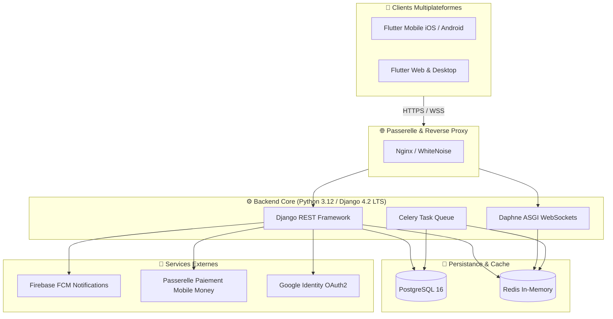

<div align="center">

  

  # 📰 DigitalPress
  ### Plateforme de Presse Numérique de Nouvelle Génération
  
  **Une solution complète, sécurisée et souveraine de kiosque numérique et de distribution de contenus multimédias pour l'Afrique et l'international.**

  <p align="center">
    <a href="#-fonctionnalités-clés">✨ Fonctionnalités</a> •
    <a href="#️-architecture--stack-technique">🏗️ Architecture</a> •
    <a href="#-démarrage-rapide">🚀 Démarrage Rapide</a> •
    <a href="#-comptes-de-démonstration">🔑 Comptes de Test</a> •
    <a href="#-sécurité--audits">🔒 Sécurité</a> •
    <a href="#-roadmap--vision">🗺️ Roadmap</a>
  </p>

  <!-- Shields Badges -->
  <p align="center">
    
    
    
    
    
    
  </p>

  <p align="center">
    
    
    
    
    
  </p>

</div>

---

## 🌟 Aperçu du Projet

**DigitalPress** réinvente l'accès à la presse écrite, aux magazines et aux revues spécialisées grâce à une suite logicielle unifiée combinant :
- 📱 **Une application mobile & multiplateforme ultra-fluide** conçue sous Flutter (Riverpod, Syncfusion PDF Viewer avec filigrane dynamique anti-fuite).
- ⚙️ **Un backend haute performance robuste** sous Django REST Framework, Daphne (ASGI/WebSockets), PostgreSQL, Redis et Celery.
- 💳 **Une intégration de paiements locaux et internationaux** (Mobile Money via Movapay, Wave, Orange Money, MTN Moov, Cartes Bancaires).
- 🛡️ **Un modèle économique vertueux sans barrière à l'entrée** : accès éditeur sans frais initiaux, paliers automatiques par volume et sécurisation stricte des droits d'auteur.

<div align="center">
  
</div>

---

## ✨ Fonctionnalités Clés

### 🔒 Sécurité & Protection du Contenu (DRM Hybride)
- **Filigrane Dynamique Anti-Capture** : incrustation transparente et dynamique de l'email et de l'identifiant du lecteur sur chaque page du lecteur PDF pour décourager les fuites.
- **Stockage Trousseau Sécurisé** : Tokens JWT persistés au sein du Keychain iOS et du Keystore Android via `flutter_secure_storage`.
- **Révocation & Renouvellement Transparent** : Gestionnaire automatique de rafraîchissement des jetons avec intercepteur Dio sans déconnexion utilisateur.
- **Authentification Double Niveau** : Inscription durcie avec code OTP par e-mail (validité 15 min, max 5 tentatives) et OAuth2 Google avec vérification cryptographique de signature.

### 👥 Expérience Éditeurs (Modèle Économique Innovant)
- **Zéro Droit d'Entrée** : Aucun abonnement imposé aux éditeurs. Activation directe par l'administrateur.
- **Paliers Évolutifs Automatiques** : Calcul dynamique du palier (`Basique` → `Standard` → `Premium`) basé sur le nombre de parutions, de ventes et d'abonnés actifs.
- **Monétisation Juste** : Rémunération de la plateforme via commission prélevée exclusivement sur les ventes réelles.
- **Dashboard Analytique** : Graphiques de revenus, taux d'engagement et suivi des téléchargements en temps réel via `fl_chart`.

### 📖 Expérience Lecteurs & Abonnés
- **Kiosque Interactif** : Découverte des dernières unes, filtrage par catégories, recherche textuelle et flux thématiques.
- **Lecteur PDF Haute Performance** : Rendu fluide accéléré matériellement multiplateforme avec `Syncfusion PDF Viewer`.
- **Courtes Vidéos & Multimédia** : Player vidéo optimisé avec gestion du plein écran sans rechargement.
- **Abonnements Dédiés** : Possibilité de s'abonner directement à ses journaux et éditeurs favoris.

---

## 🏗️ Architecture & Stack Technique



### 🧰 Boîte à Outils Technologique

| Domaine | Technologies & Librairies | Rôle & Utilité |
| :--- | :--- | :--- |
| **Mobile Core** | `Flutter 3.x`, `Dart 3.x` | Développement cross-platform natif iOS, Android, Desktop, Web |
| **State & Route** | `flutter_riverpod 2.4`, `go_router 13.x` | Injection d'états réactive, cache d'état et routage déclaratif |
| **Lecteur & Média**| `syncfusion_flutter_pdfviewer`, `video_player` | Rendu PDF haute fidélité, annotations filigranées, lecture vidéo |
| **Network & Sécu** | `dio 5.4`, `flutter_secure_storage 9.0` | Client HTTP avec intercepteurs JWT, stockage trousseau chiffré |
| **Backend API** | `Django 4.2 LTS`, `Django REST Framework` | API REST modulaire et sécurisée avec documentation Swagger/OpenAPI |
| **Temps Réel** | `Channels 4.1`, `Daphne 4.1`, `channels-redis` | Serveur ASGI et gestion des WebSockets pour notifications directes |
| **Base de Données** | `PostgreSQL 16`, `psycopg2` | Données relationnelles ACID, transactions comptables |
| **Cache & Queue** | `Redis 5.0`, `Celery 5.3`, `django-celery-beat` | Cache haute vitesse, tâches asynchrones et cron jobs programmés |
| **Infra & DevOps** | `Docker`, `Docker Compose`, `Systemd`, `Nginx` | Conteneurisation locale et déploiement direct VPS résilient |

---

## 📂 Structure du Répertoire

```bash
DigitalPress/
├── 📁 assets/                     # Icônes officielles, images de marque et maquettes
├── 📁 backend/                    # Serveur API Django REST Framework
│   ├── 📁 apps/                   # Modules métiers découplés
│   │   ├── accounts/              # Utilisateurs, OTP e-mail, RBAC, profils
│   │   ├── publications/          # Journaux, magazines, articles, éditions
│   │   ├── abonnements/           # Plans lecteurs, calcul automatique paliers éditeurs
│   │   ├── paiements/             # Webhooks, Mobile Money, Movapay
│   │   ├── comptabilite/          # Grand livre, commissions, bilans financiers
│   │   ├── notifications/         # Alertes in-app & intégration FCM
│   │   └── roadmap/               # Suivi des évolutions et retours
│   ├── 📁 config/                 # Paramètres Django, routage ASGI/WSGI, Celery
│   ├── 📄 requirements.txt        # Dépendances Python 3.12 verrouillées
│   └── 📄 Dockerfile              # Image conteneurisée optimisée
├── 📁 lib/                        # Application cliente Flutter
│   ├── 📁 config/                 # Thèmes, constantes d'environnement, typographie
│   ├── 📁 core/                   # ApiClient Dio, intercepteurs JWT, routeur
│   ├── 📁 model/                  # Entités immuables (User, Publication, etc.)
│   ├── 📁 screens/                # Vues (Kiosque, Auth, Lecteur PDF sécurisé, Profil)
│   └── 📁 widgets/                # Composants atomiques réutilisables
├── 📁 scripts/                    # Utilitaires d'orchestration Windows & Linux/macOS
├── 📄 docker-compose.yml          # Stack complète (PostgreSQL, Redis, Backend)
├── 📄 pubspec.yaml                # Manifeste et dépendances Flutter
└── 📄 README.md                   # Documentation officielle du projet
```

---

## 🚀 Démarrage Rapide

### Prérequis
- [Flutter SDK](https://flutter.dev/docs/get-started/install) (>= 3.0.0)
- [Python](https://www.python.org/) 3.12+ (si exécution locale hors conteneur)
- [Docker & Docker Compose](https://www.docker.com/) (recommandé pour une mise en route en un clic)

---

### Option 1 : Stack Complète avec Docker (Recommandé)

Lancez l'ensemble de l'infrastructure backend (`PostgreSQL 16` + `Redis` + `Django REST API`) depuis la racine :

#### 🪟 Windows (PowerShell)
```powershell
.\scripts\docker-up.ps1
```

#### 🐧 Linux / 🍎 macOS
```bash
chmod +x scripts/docker-up.sh
./scripts/docker-up.sh
```

#### ⚙️ Manuellement via Docker CLI
```bash
docker compose up --build -d
```

> 🌐 **Points d'accès :**
> - **API REST Root** : `http://127.0.0.1:8000/api/`
> - **Swagger & Documentation Interactive** : `http://127.0.0.1:8000/api/docs/`
> - **Console d'Administration Django** : `http://127.0.0.1:8000/admin/`

---

### Option 2 : Exécution Locale Manuelle (Sans Docker)

<details>
<summary>▶️ Cliquez pour déplier les commandes pas-à-pas (Python venv)</summary>

```bash
# 1. Accéder au sous-dossier backend
cd backend

# 2. Créer et activer l'environnement virtuel
python -m venv venv
source venv/bin/activate       # Linux/macOS
# ou : .\venv\Scripts\Activate.ps1  # Windows PowerShell

# 3. Installer les dépendances
pip install -r requirements.txt

# 4. Appliquer les migrations et initialiser la base
python manage.py migrate

# 5. Démarrer le serveur ASGI de développement
python manage.py runserver 0.0.0.0:8000
```
</details>

---

### Option 3 : Lancer l'Application Flutter

Dans un second terminal, lancez le client sur votre cible préférée (émulateur, téléphone physique, Chrome ou Desktop) :

```bash
# Récupération des paquets Flutter
flutter pub get

# Lancement sur votre périphérique connecté
flutter run
```

*Sous Windows, vous pouvez également lancer directement le script d'automatisation :*
```powershell
.\scripts\run-flutter.ps1
```

---

## 📱 Environnements & URLs API

L'application Flutter adapte intelligemment son URL de base selon l'environnement d'exécution :

| Environnement Cible | URL API configurée | Note de connectivité |
| :--- | :--- | :--- |
| **Navigateur Web / Windows / Simulateur iOS** | `http://127.0.0.1:8000/api/` | Boucle locale directe (`localhost`) |
| **Émulateur Android Standard** | `http://10.0.2.2:8000/api/` | Passerelle hôte réservée Android Studio |
| **Téléphone Physique (même Wi-Fi)** | `http://<VOTRE_IP_LOCALE>:8000/api/` | Détectée automatiquement par `start_backend.ps1` |
| **Serveur Production VPS** | `http://192.162.71.56/api/` | Nginx reverse-proxy via Daphne |

---

## 🔑 Comptes de Démonstration

Pour faciliter vos tests et la revue de code, un jeu complet d'utilisateurs pré-configurés est mis à disposition :

| Rôle Métier | Identifiant | Mot de Passe | Permissions |
| :--- | :--- | :--- | :--- |
| 🛡️ **Administrateur** | `admin` | `Admin123!` | Accès superutilisateur complet & Django Admin |
| ✍️ **Éditeur Actualités** | `editeur_afrique` | `Editeur@2024!` | Publication presse, gestion tarifs & retraits |
| 💻 **Éditeur Tech & Mag** | `editeur_tech` | `Editeur@2024!` | Gestion magazines high-tech & abonnements |
| 📖 **Lecteur Particulier** | `client_yao` | `Client@2024!` | Consultation kiosque, lecteur PDF, achats |
| 📖 **Lectrice Abonnée** | `client_fatou` | `Client@2024!` | Historique de lecture & souscriptions |

---

## 🔒 Sécurité & Audits

Le projet a fait l'objet d'audits de durcissement approfondis avec application stricte des meilleures pratiques de sécurité :

- 🛡️ **Vérification Stricte Google OAuth2** : Révocation de tout décodage aveugle sans validation de certificat Google (`verify_oauth2_token`).
- 🔐 **Flux Inscription avec E-mail OTP** : Activation conditionnée par un jeton numérique éphémère (validité 15 min, limite de tentatives).
- 🌐 **Politique CORS Sécurisée** : Blocage du wildcard `CORS_ALLOW_ALL` en production au profit d'origines certifiées.
- 💧 **Protection du Droit d'Auteur** : Watermarking dynamique intégré directement sur le canvas PDF côté client.
- 💳 **Intégrité Financière** : Aucun prélèvement caché pour les créateurs ; validation cryptographique des signatures de webhooks de paiement.

---

## 🛠️ Commandes Utiles de Maintenance

```bash
# 📦 Régénération du code automatisé (Riverpod, JSON Serializable)
flutter pub run build_runner build --delete-conflicting-outputs

# 🧪 Exécution des tests unitaires et d'intégration Flutter
flutter test

# 📜 Suivi des logs backend sous Docker
docker compose logs -f backend

# 🛑 Arrêt propre des conteneurs
docker compose down

# 🔄 Réinitialisation complète avec remise à zéro des volumes BDD
docker compose down -v && docker compose up --build -d
```

---

## 🗺️ Roadmap & Vision

- [x] Architecture modulaire Django 4.2 LTS & Flutter 3.x
- [x] Lecteur PDF sécurisé avec filigrane dynamique
- [x] Gestion automatique des paliers de performance éditeurs
- [x] Intégration passerelle Mobile Money & notifications push FCM
- [ ] Mode lecture hors-ligne avec stockage chiffré local (AES-256)
- [ ] Synthèse vocale IA (Text-to-Speech) pour écoute des articles
- [ ] Application dédiée kiosque Android TV et liseuse e-ink

---

<div align="center">

  **DigitalPress** • Développé avec excellence pour moderniser l'accès à l'information.

  <sub>Des questions ou des suggestions ? N'hésitez pas à ouvrir une issue ou proposer une pull request !</sub>

</div>
